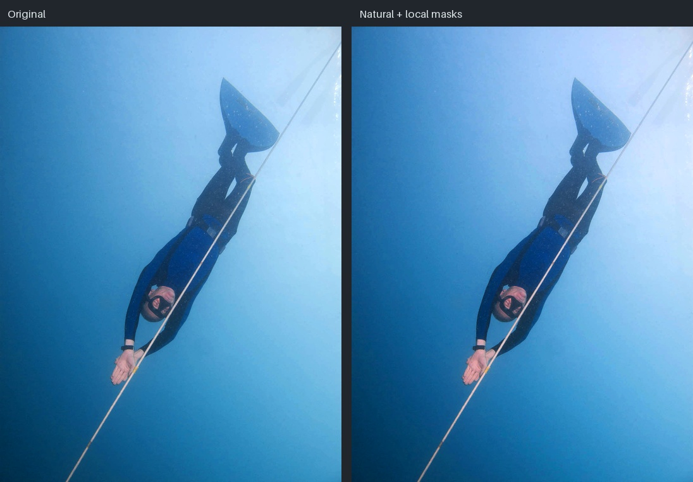
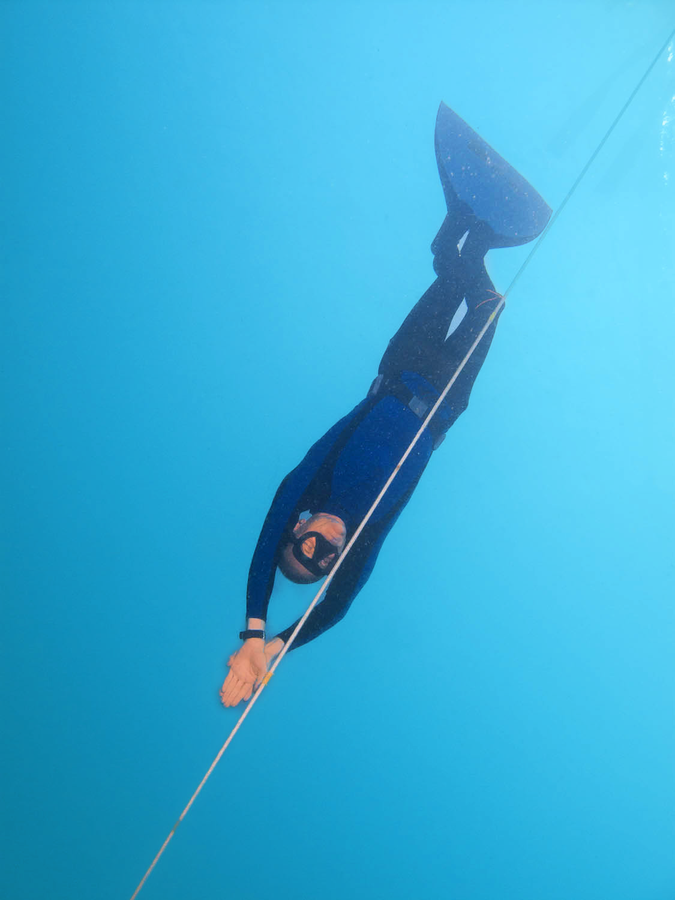
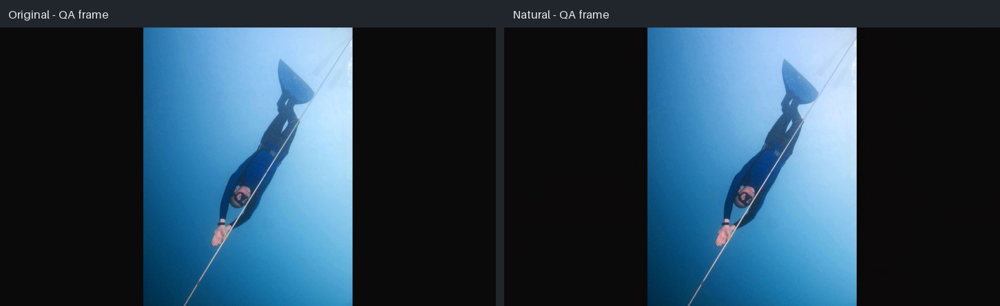
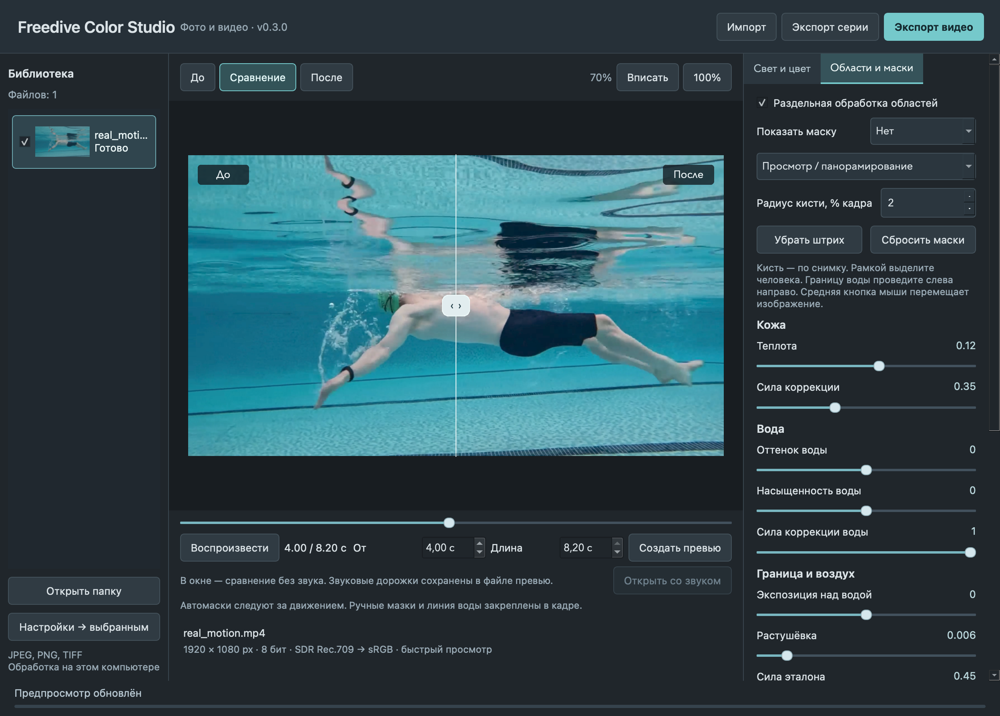

# Фактическая проверка Freedive Color Studio 0.3.0

Дата: 27 октября 2026. Этапы A/B/C реализованы и приняты. Для D подготовлены автономные дистрибутивы; ниже отделены выполненные действия от неподтверждённых платформ.
Историческая приёмка A сохранена в [docs/TESTING_MVP_A.md](docs/TESTING_MVP_A.md).

## Окружение и автоматические проверки

macOS 26.6.2 arm64, Apple M4, 24 ГБ RAM. Python 3.12.13, PySide6 Essentials 6.8.3,
NumPy 2.5.4, OpenCV 4.14.0.94 image-only, Pillow 13.0.0, tifffile 2026.10.15,
PyAV 15.1.0/FFmpeg 7.1.1, PyInstaller 6.22.3. Windows-пакет использует отдельный
официальный PyAV 16.1.0/FFmpeg 8.0.1 и CPython 3.13.17; запуск на Windows ещё не выполнен.

- A: 83 теста, фото-MVP, исходный bundle smoke.
- B: 178 тестов, локальные маски, эталон, проекты, серия из 20 файлов без ошибок.
- C: полный прогон после замены нативного OpenCV — **240 passed, 0 failed, 50.60 с**.
  Отчёт: `artifacts/milestone-c-tests.xml`. Итоговый прогон D: **271 passed, 0 failed, 17.77 с**, `artifacts/final-tests.xml`; Ruff lint/format прошли.
- OpenCV source wheel: 57 профильных тестов, JPEG/PNG/TIFF/16-bit, DNN/Farneback/G-API.
  FFmpeg/AVFoundation отключены; совместный импорт с PyAV без конфликтующих классов.
  Все build flags и SHA — `build/opencv-image-only/native-manifest.json`.

Проверки включают исходную геометрию/массивы, защиту файлов и sidecar rollback,
отмену/диск/коллизии, 16-bit градиенты, EXIF/ICC/alpha, HDR-отказ, маски и ручное
уточнение, раздельный воздух, сохранение освещения серии, проекты и CLI recipe replay.
Qt-тесты проверяют drag/drop, регуляторы, сравнение, Retina 100%, фоновые задания,
быстрое переключение файлов, timeline, настоящий paired playback, fractional VFR,
превью/экспорт со звуком и сохранение эталона выбранного видеокадра.

## Реальные изображения и серии

Источник: Andy Moreno, [Freediver Moalboal](https://commons.wikimedia.org/wiki/File:Freediver_Moalboal.jpg),
public domain. SHA-256 `771ad767283bb15f5fd47c7c5a3960219b802601f73193ab22f9ad0ec5b2005b`.
Снимок уже обработан автором и не является измерительной цветовой мишенью.





Серия B: 20 completed, 0 failed, исходники не изменены. Надводная область при
нулевом отдельном EV совпадает с оригиналом (max change 0). Палитра согласуется
без механического выравнивания света: диапазон яркости 0.15106 → 0.15297.
Полные результаты: `artifacts/milestone-b-final`, окно: `artifacts/milestone-b-gui`.

## Видео и временная согласованность

Два 12-секундных контрольных 1080p ролика по 288 кадров экспортированы полностью.
Они созданы из реального фото, синтетического изменения света/цвета и звука.
Статичный ролик: все 564 исходных аудиопакета совпали; ошибки video PTS, audio PTS/DTS,
начала и длительности треков равны 0. Добавленный шаг яркости −0.00000857,
дополнительное pumping на статичной мишени не выявлено.

Depth-change: найден жёсткий переход около 6.625 с при построенной границе 6.6 с;
PTS/звук сохранены. Всего завершены 5 полных экспортов: 1001 кадр и 2126 исходных
аудиопакетов; во всех ошибка PTS/DTS, начала и длительности треков равна 0.
Короткий 3840×2160 ролик — 4 кадра за 33.394 с; настоящее движение пловца —
8.2 с / 205 кадров за 363.136 с. VFR-превью 10 с содержит 180 кадров и 469 исходных
AAC-пакетов с общим сдвигом 1.25 с и нулевой ошибкой часов. Отмена после 12
закодированных кадров удаляет текущий результат/staging. Peak RSS всей проверки,
включая 4K, — 1.681 GiB. Все исходники, включая первоначальный WebM, неизменны.
Финальная независимая сверка: `artifacts/milestone-c-final/evidence.json` и копия
`docs/evidence/milestone-c-results.json`. Тест живого движения — бассейн, а не
открытое море; часть кадров требует ручного уточнения кожи.





Атрибуция движущегося тестового медиа и CC BY-SA 4.0 —
[docs/evidence/ATTRIBUTION.md](docs/evidence/ATTRIBUTION.md).

Полный CLI экспорт и повторение по JSON совпали по пикселям всех 9 декодированных
кадров и 37 исходным аудиопакетам: `artifacts/milestone-c-cli/verification.json`.
Unit/integration проверяют также HEVC SDR 10-bit, повороты ±90/180°, две аудиодорожки
с разным языком/началом, MOV/PCM и отказ вместо скрытого перекодирования звука.

Обработка потоковая по пикселям: целый ролик не хранится в памяти. Скорость CPU
не заявляется как realtime. Первые два 1080p прогона под параллельной нагрузкой
сборки/тестов заняли 543.234 с и 422.748 с. Это измерения конкретного компьютера,
не прогноз для другого железа или сложного шумоподавления.

## Дистрибутивы и пределы проверки

| Цель | Фактический статус |
| --- | --- |
| macOS arm64 0.3.0 | `.app` и ZIP собраны; 144 Mach-O с minimum OS ≤13; фото/модель и видео GUI smoke без сети прошли |
| Распаковка macOS ZIP | Запуск из отдельной папки с русским именем/пробелами; реальное paired playback, VFR/audio экспорт; все 72 звуковых пакета и часы совпали |
| Windows x64 | Portable подготовлен: настоящие GUI/CLI `.exe`, частный runtime, source-built IPP-free cv2, проверенная AMD64 DLL-closure; запуск на Windows не выполнялся |
| macOS Intel | Сценарий и CI-матрица; сборка/запуск в этой сессии не выполнялись |
| macOS 13 / чистая машина | Проверены заголовки minimum OS; фактического запуска на macOS 13 или чистой машине не было |
| Подпись издателя | Developer ID/Authenticode/notarization отсутствуют; техническая ad-hoc подпись не является подписью издателя |

Проверка готового приложения очищает окружение Python и PATH; на macOS процессу
запрещается сеть через системный механизм. Установленный Python не удаляется:
это проверка изоляции runtime от окружения разработки, а не тест чистой ОС.
Наличие GitHub Actions workflow не означает удалённый запуск; репозитория/CI-run
для этого проекта в текущей сессии нет. Подготовленная Windows-сборка не выдаётся
за проверку на Windows.

Соответствующие исходники, полные лицензии и recipes предоставляются отдельным
source ZIP рядом с дистрибутивами. macOS и Windows имеют разные нативные наборы;
манифест указывает точную проверенную область.
Обязательные архивы GNU/Qt компонентов включены; часть остальных исходников
предоставлена точными URL, версиями/commit и контрольными суммами в source-access
записях. Эти ссылки не выдаются за байты, уже находящиеся в архиве.

Дополнительно проверен локальный вертикальный фридайв-ролик 720×1280: короткое
превью сохранило 48 кадров и 86 аудиопакетов с нулевой ошибкой часов. Исходник
не изменён. Эти медиаданные и результаты находятся только в рабочей папке,
исключены из Git и архивов исходников.

## Воспроизведение

```sh
uv run --no-sync ruff check .
uv run --no-sync ruff format --check .
uv run --no-sync pytest -q --junitxml=artifacts/tests.xml
uv run --no-sync python tools/generate_video_fixtures.py --output artifacts/new-video-inputs --duration 12
uv run --no-sync python tools/render_video_evidence.py --inputs artifacts/new-video-inputs --output artifacts/new-video-check
uv run --no-sync python tools/build_desktop.py
uv run --no-sync python tools/smoke_bundle.py
```

Используйте новую папку для повторного экспорта. Подготовка окружения и сборка
требуют доступа к официальным источникам зависимостей; готовое приложение работает
офлайн. Ограничения масок, HDR, цветового монитора и статичных ручных мазков
перечислены в README.md и DECISIONS.md.

## MCP и общее состояние — 0.4.0

Полный локальный прогон: **406 passed, 0 failed, 20.72 с**,
`artifacts/mcp-final-tests.xml`. Ruff проверил 104 Python-файла. Тесты покрывают:

- Настоящий SDK 2.3.0 stdio: 15 инструментов, строгие диапазоны/типы/unknown fields,
  ленивый запуск, единые ошибки и запрет media/binary/oversized ответов. Python
  print и native stdout не попадают в поток JSON-RPC.
- Настоящий QLocalSocket: фрагменты UTF-8, несколько сообщений за чтение, лимиты
  запроса/ответа, неверный токен/API, singleton/stale process, переподключение,
  скрытие окна и неблокирующее завершение очереди.
- Контроллер и GUI: атомарные ревизии, общий/индивидуальный пресет, сохранение
  масок/локальных поправок, очередь и отмена серии с сохранением готового файла,
  неизменяемые snapshots, stale preview/reference и interrupted-журнал.
- Регрессии смены файла/настроек во время GUI-экспорта, точные target IDs серии,
  отделение старого video plan/proxy и синхронизация времени воспроизведения.
- Совместимый `.fcsproj` схемы 1 без служебных MCP UUID, новый session/media IDs
  при загрузке, read-only summaries больших масок и постраничное чтение.

`tools/smoke_control.py` дополнительно общается с настоящим приложением через SDK
и stdio, импортирует три настоящих кодированных тестовых видео, делает групповую
и индивидуальную правку, proxy и полный экспорт. Отключает адаптер во время
running, подключает новый и проверяет прежний PID/session. После запуска меняет
настройку, сверяет неизменяемый экспортный рецепт, все PTS/аудиопакеты и SHA
исходников. Не передаёт кадры или звук модели и не заявляет визуальную приёмку.

Source-проверка: `artifacts/mcp-source-smoke/result.json`; frozen-проверки:
`artifacts/mcp-bundle-smoke/result.json` и финальная проверка распакованного ZIP
`artifacts/mcp-installed-smoke/result.json`. Прогон на текущем Mac запрещает
внешние IP-подключения, оставляя локальный Unix-канал; child PATH не содержит
Python/FFmpeg разработчика. Это проверка изоляции, а не удаление Python с хоста
или проверка чистой macOS 13.

```sh
uv run --no-sync python tools/smoke_control.py --output artifacts/new-mcp-source-test
uv run --no-sync python tools/smoke_control.py \
  --output artifacts/new-mcp-bundle-test \
  --adapter "dist/Freedive Color Studio.app/Contents/MacOS/freedive-color-mcp" \
  --application "dist/Freedive Color Studio.app/Contents/MacOS/Freedive Color Studio"
```

Каждый прогон требует новую папку. Он использует отдельный приватный реестр и
завершает только свой тестовый процесс после проверки; существующий проект не
затрагивается. В Windows checker добавлен независимый stdlib stdio handshake
готового EXE и проверка QtNetwork/COM. Эти Windows-проверки подготовлены, но в
этой macOS-сессии Windows EXE не исполнялся. Windows x64, Intel Mac и чистая
macOS 13 остаются явно непроверенными платформами. Нативная Qt-работа текущего
Mac подтверждена; ошибка `neon` из ограниченного диагностического запуска её
не воспроизводит при проверенном нативном запуске.
