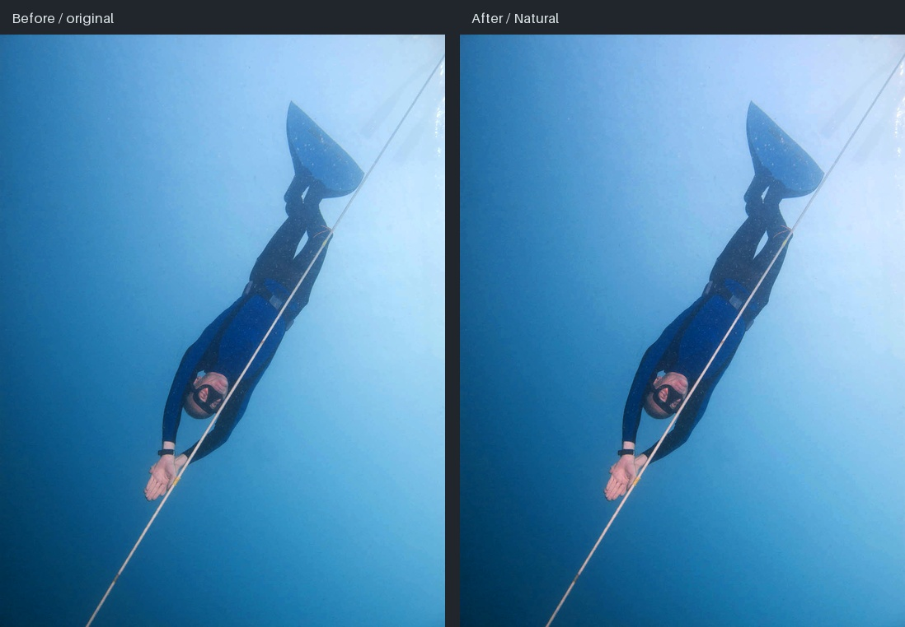
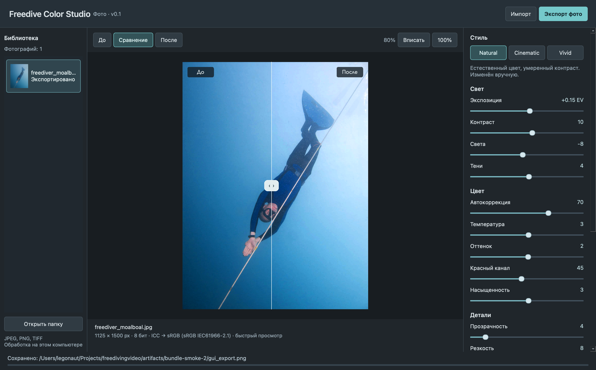

# Проверка этапа A — 27 октября 2026

**Результат: рабочий фото-MVP. 83 passed, 0 failed.**
Это приёмка этапа A; маски, серии, видео и поставка на обеих чистых платформах
ещё не реализованы/не приняты. Сводные данные: [results.json](evidence/results.json).

## Что было запущено

macOS **26.6.2 arm64**, Apple M4, **24 ГБ RAM**. Python **3.12.13**,
PySide6 Essentials **6.8.3**, NumPy **2.5.4**, OpenCV **4.14.0.94**,
Pillow **13.0.0**, tifffile **2026.10.15**, PyInstaller **6.22.3**.

Из корня проекта:

```sh
.venv/bin/ruff check .
.venv/bin/ruff format --check .
.venv/bin/pytest -q --junitxml=artifacts/tests.xml
.venv/bin/python tools/generate_fixtures.py
.venv/bin/python tools/render_evidence.py --output artifacts/final
.venv/bin/python tools/build_desktop.py
.venv/bin/python tools/smoke_bundle.py
```

Новая установка зависимостей на Apple Silicon:

```sh
uv sync --frozen --python-platform aarch64-apple-darwin --extra dev --extra build
```

При повторе демо выбирайте новый каталог: экспорт не перезаписывает существующие
файлы. `smoke_bundle.py` самостоятельно выбирает свободный `bundle-smoke[-N]`.

## Покрытие и результаты

| Проверка | Результат |
| --- | --- |
| Unit, integration, GUI и контролируемые визуальные тесты | 83 passed, 0 failed |
| Ruff lint / format | passed / passed |
| Реальный JPEG → Natural/Cinematic/Vivid → PNG | выполнено |
| Настоящее окно → импорт → экспозиция +0.15 EV → экспорт | выполнено из исходников и из `.app` |
| Drag & drop, кнопки стилей, регулятор с клавиатуры, линия сравнения | проверены Qt GUI-тестом |
| Полный 100%, загрузка source pixels вместо proxy | проверено, включая корректировку для Retina |
| Отзывчивость UI при фоновом чтении | проверена работой main event loop во время worker |
| Быстрое переключение файлов, устаревший worker | проверено |
| EXIF Orientation | все 8 значений, PNG и TIFF 8/16-bit |
| 16-bit PNG/TIFF | round-trip, 2048 разных уровней; понижения до 256 нет |
| ICC, повреждённый профиль, прозрачность и RGB transparency key | проверено |
| Float TIFF, PQ PNG, HDR gain-map JPEG, нестандартная gamma | явный отказ |
| Битый файл, повторная успешная загрузка, нехватка места | проверено |
| Защита оригиналов и существующих файлов, отмена и rollback sidecar | проверено |
| Файловая система без hard links | exclusive-copy fallback проверен имитацией отказа hard link |
| Повтор по JSON-рецепту и SHA-256 исходника | пиксели результата совпадают |
| Нулевые регуляторы / исходный массив / геометрия | identity / неизменён / неизменна |
| Отсутствующий красный | red recovery не создаёт сигнал, выдаёт предупреждение |
| Равномерная вода и градиент | без пространственных пятен, сохраняется синяя палитра |
| Готовая `.app` с системным запретом сети | импорт, ручная правка, экспорт успешны |
| Все Mach-O в `.app` | 161, требований выше macOS 13 нет |
| ZIP integrity | OK |

`tests/conftest.py` устанавливает offscreen только для pytest; отдельное smoke-демо
использовало обычное видимое окно Cocoa. Финальный bundle smoke запускался с
очищенными переменными окружения Python и PATH `/usr/bin:/bin` из родительской
папки, с запретом `(deny network*)` для процесса. Установленный системный Python
не удалялся; это изоляция от окружения разработки, а не тест чистой машины.

## Фактические результаты обработки

Источник — реальное фото **Freediver Moalboal**, Andy Moreno, public-domain
dedication на [Wikimedia Commons](https://commons.wikimedia.org/wiki/File:Freediver_Moalboal.jpg).
Файл не изменён, SHA-256:

```text
771ad767283bb15f5fd47c7c5a3960219b802601f73193ab22f9ad0ec5b2005b
```

Все результаты — **1125×1500**, 8-bit PNG sRGB, без текста, водяных знаков,
перекадрирования или синтеза объектов. Контактное сравнение ниже — отдельный
артефакт проверки, не формат экспорта приложения.





Полноразмерные файлы в рабочей папке:

- `artifacts/final/before.png`, `natural.png`, `cinematic.png`, `vivid.png` и sidecar.
- `artifacts/final/evidence.json` — времена, изменения цвета, контрольная сумма.
- `artifacts/bundle-smoke-2/gui_export.png`, `gui_smoke.json`, `app_window.png`.
- `artifacts/tests.xml`, `artifacts/macos-targets.json`, `artifacts/build-macos.log`.

Natural умеренно повышает существующий красный, слегка меняет контраст и сохраняет
синюю воду, текстуру костюма и исходные детали. Снимок уже был обработан автором;
по нему нельзя измерить точность восстановления утраченного цвета или качество
на разных оттенках кожи. Семантическая маска/отдельная коррекция кожи здесь не проверялась.

## Большое фото

Отдельно создан и обработан синтетический SDR RGB-градиент **6000×4000 (24 Мп)**:

| Метрика | Результат на этом Mac |
| --- | --- |
| Preview, включая чтение | 0.398 с |
| Полный экспорт PNG | 3.259 с |
| Peak RSS процесса | 2495.8 MiB |

Команда: `.venv/bin/python tools/benchmark_photo.py`; результат —
`artifacts/benchmark/benchmark.json`. Это один прогон синтетического градиента;
сложное сжатие, ICC и denoise могут увеличить время. Экспорт не потоковый по плиткам.

## Сборки

| Платформа | Артефакт | Реально проверено |
| --- | --- | --- |
| macOS arm64 | `dist/Freedive Color Studio.app`, около 220 МБ | сборка и запуск на macOS 26.6.2 |
| macOS arm64 | `dist/Freedive-Color-Studio-macOS-arm64.zip`, около 85 МБ | архив проверен, bundle smoke успешен |
| Windows x64 | `packaging/windows/build.ps1`, CI `windows-latest` | подготовлены; сборка/запуск не выполнялись |
| macOS Intel | CI `macos-15-intel` | подготовлен; сборка/запуск не выполнялись |
| macOS 13 | deployment target ≤13, `LSMinimumSystemVersion=13.0` | реальные библиотеки проверены; запуска на 13 не было |

Дистрибутив имеет только техническую ad-hoc подпись; Developer ID, Authenticode и
notarization отсутствуют. Чистая машина без установленного Python не проверялась.
Критерий этапа D о поставке на Windows/macOS ещё не выполнен.

## Известные ограничения и следующий этап

Глобальные регуляторы меняют воду и кожу вместе. Нет масок, кисти, разделения
неба/воды, reference match, массового экспорта или видео. Высокая экспозиция
может обрезать света; сильные ручные поправки могут усилить шум и сдвинуть кожу.
Исходные алые/оранжевые оттенки при отсутствии красного неизвестны алгоритму.
Монитор в wide-gamut режиме не проверен; для цветовой оценки нужен режим sRGB.
Поддержка 16-bit ICC и метаданных ограничена, как описано в README.

Далее — этап B: отдельная skin mask внутри области человека с проверкой уверенности,
water mask, ручное уточнение, split-level, reference match и серии. Приёмка B
потребует реальных согласованных примеров кожи и экипировки; текущие цветовые
мишени не подтверждают способность отличать купальник от кожи.
